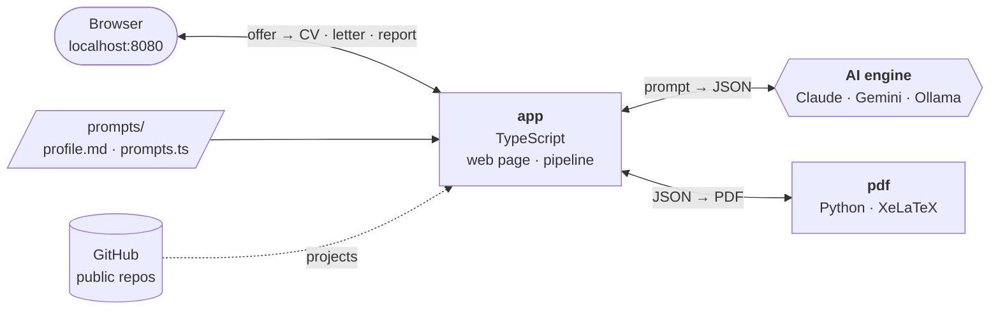
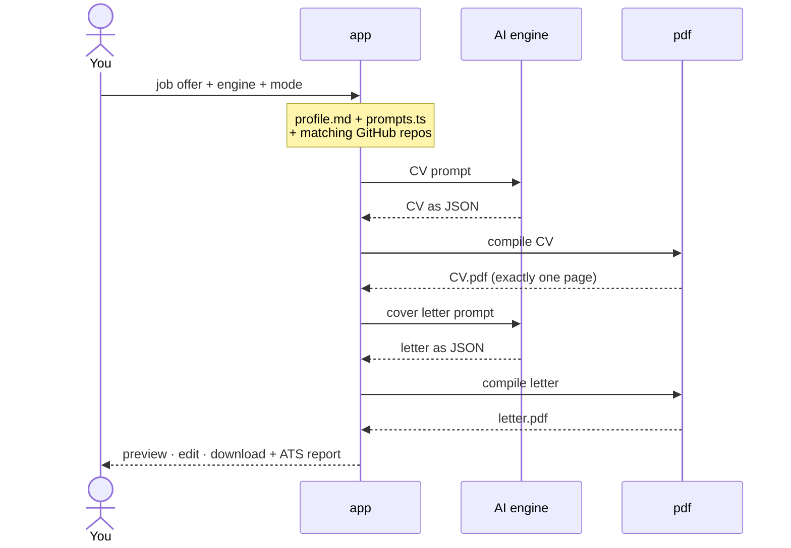

<div align="center">

# CV & Cover Letter Generator

**Paste a job offer. Get a one-page, ATS-ready CV and a cover letter — as PDFs.**


</div>

---

## Features

- **Tailored to the offer** — headline, summary, skills and bullets rewritten with the offer's own keywords
- **One page, always** — the layout picks the largest font that still fits exactly one page
- **ATS report** — keywords covered, plus everything added beyond your real profile, to prepare interviews
- **Your GitHub, matched** — the 2–3 public repos most relevant to the offer, linked on the CV
- **Stack at a glance** — every technology is printed in bold
- **Edit before download** — fix any line in the page, the PDF is rebuilt in seconds, no AI call
- **Every CV kept** — saved in a local SQLite database, browsable in a table, exportable to CSV
- **Three engines** — Claude (Pro plan), Gemini (free tier) or a local open-source model
- **Private** — runs on your machine, listens on `localhost` only

## How it works



<details>
<summary>One generation, step by step</summary>



</details>

| Service | Role |
|---|---|
| `app` | Web page, pipeline, engine calls — `http://localhost:8080` |
| `pdf` | JSON → PDF with XeLaTeX, reachable only by `app` |
| `ollama` | Local model (`qwen2.5:3b`), started only for the local engine |

## Quick start

**Requirements:** Docker and docker-compose. At least one engine: a Claude Pro plan, a [Gemini API key](https://aistudio.google.com), or ~3 GB of free RAM for the local model.

```bash
# 1. Configure
cp .env.example .env                                # keys and models
cp prompts/profile.example.md prompts/profile.md    # you: contact + profile

# 2. Build
docker-compose build

# 3. Run with the engines you want
./bots.sh all
```

Open **http://localhost:8080**, paste an offer, click **Generate**. Past CVs: **All CVs →** on the page.

<details>
<summary>Getting a Claude Code token (Pro plan)</summary>

```bash
npm i -g @anthropic-ai/claude-code
claude setup-token        # log in with your Pro account
```

Put the token in `.env` as `CLAUDE_CODE_OAUTH_TOKEN`. Never set `ANTHROPIC_API_KEY`: that would bill API prices.

</details>

## Usage

```bash
./bots.sh claude            # one engine
./bots.sh gemini local      # any combination
./bots.sh all               # all three
docker-compose down         # stop
```

The page only offers the engines you launched. `ollama` runs only with `local`.

| Engine | Cost | Speed |
|---|---|---|
| Claude | included in Claude Pro | ~2 min per document |
| Gemini | free tier | ~45 s for both |
| Local | free, offline | several minutes on CPU |

**Modes**, chosen per offer:

- **Aggressive** — titles and tasks rewritten to match the offer. Companies, dates, education and certifications never change; no invented numbers.
- **Strict** — only rephrases and reorders your real profile.

## Configuration

| File | What goes in it | Applies |
|---|---|---|
| `prompts/profile.md` | **You**: contact block + your profile in plain text | next offer |
| `prompts/prompts.ts` | Prompts and settings: default mode, headline, GitHub user, models | next offer |
| `.env` | Keys and models: `CLAUDE_CODE_OAUTH_TOKEN`, `GEMINI_API_KEY`, `OLLAMA_MODEL`… | `docker-compose up -d` |
| `data/cv.db` | Every generation: offer, content, PDFs, ATS report (SQLite, written by the app) | — |

`profile.md` starts with a contact block, printed as-is on both documents — the AI never rewrites it:

```markdown
---
name: Jane Doe
email: jane@example.com
phone: +33 6 00 00 00 00      # remove a line to leave it out
location: Paris, France
github: github.com/janedoe
linkedin: linkedin.com/in/janedoe
---

Your experience, skills and education in plain text…
```

`profile.md`, `.env` and `data/` are git-ignored.

## Project structure

```
├── bots.sh               launcher: choose the engines
├── docker-compose.yml
├── prompts/              your profile + the prompts (live-reloaded)
├── data/                 cv.db (SQLite: all your CVs), engines.json
├── app/                  TypeScript
│   ├── src/              server, pipeline, db (SQLite), engines/ (claude, gemini, ollama)
│   └── web/              the page + All CVs popup (HTML + TypeScript, compiled on the fly)
└── pdf/                  Python
    └── app/              FastAPI routes, CV layout, letter layout, LaTeX
```

## Development

| Change | Then |
|---|---|
| `prompts/*`, `app/web/*` | nothing — next offer / page refresh |
| `app/src/*` | `docker-compose up -d --build app` |
| `pdf/app/*` | `docker-compose up -d --build pdf` |

```bash
cd app && npm install && npm run typecheck    # also runs during the Docker build
docker-compose logs -f app                     # logs
```

## Resources

Idle: **~100–160 MB** for `app` + `pdf`. While generating: +200–400 MB with Claude, ~0 with Gemini, **+2.5 GB with the local model** (freed 15 min after the last offer).

## Troubleshooting

| Symptom | Fix |
|---|---|
| *engine "x" is not launched* | `./bots.sh x` |
| ❌ *Profile* | `prompts/profile.md` is missing, empty, or has no `name:` |
| Gemini *503 / 429* | Google overloaded or daily quota used — the fallback model is tried automatically |
| Claude *429* | Pro limit reached (shared with claude.ai) — wait, or use `haiku` in `prompts.ts` |
| Local *model not found* | still downloading: `docker-compose logs -f ollama` |
| `KeyError: 'ContainerConfig'` | `docker-compose down`, then `./bots.sh …` |
